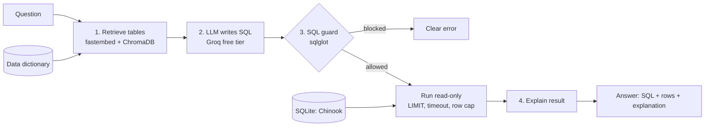

# SQL + RAG Analyst (with MCP)


Ask a plain-English question about a database. The system **retrieves the relevant tables** from a data dictionary (RAG), has an **LLM write read-only SQL**, **validates it with a parser-based guard**, runs it safely, and **explains the result**. The same pipeline is exposed as an **MCP server** (for AI agents) and a **FastAPI service**, and it is evaluated on 40 questions with verified gold SQL.

**[Recorded demo page](https://anjalikaekanayaka.github.io/sql-rag-analyst/)**: real pipeline outputs, each checked automatically against the verified answer (one failure included on purpose). There is no live backend: the project needs a Python server and a rate-limited free LLM API, and Hugging Face requires a paid plan to create Docker Spaces (as of November 2026). Run it locally with the steps below.

**Tech stack:** Python 3.12, SQLite (Chinook sample database), fastembed (`BAAI/bge-small-en-v1.5`), ChromaDB, rank_bm25, Groq API (free tier), sqlglot, FastAPI, MCP Python SDK 2.x, pytest, GitHub Actions, Docker.

## Highlights

- **Evaluated honestly:** 40 questions with execution-verified gold SQL. Execution accuracy is 97.5% with all tables allowed and **87.5% to 90% under strict, least-privilege conditions**, which is the conservative figure.
- **Retrieval is the bottleneck, not generation:** when the right tables were retrieved, the model was correct 35 of 36 times. Prompt tweaks and a retry loop added cost and no accuracy.
- **Found and corrected my own inflated baseline:** the prompt's foreign-key lines were leaking table names. Controls showed that.
- **Safety layers inside the server:** parser-based single-SELECT guard, table allowlist, read-only connection, timeout, row cap, audit log, about 30 attack-case tests.
- **Two interfaces over one pipeline:** an MCP server and a FastAPI service, with TODO-FILL tests, CI, and a Docker image built and smoke-tested in CI.

## How it works



- **Retrieval:** the dictionary (11 tables, 64 columns) is split into 28 chunks, embedded with `BAAI/bge-small-en-v1.5` (ONNX, runs on a 4 GB laptop) and stored in ChromaDB. Each question retrieves the top-k tables (k=4 by default).
- **Generation:** an LLM behind a small provider interface (Groq free tier, `openai/gpt-oss-20b` by default), with an on-disk cache and retry/backoff so the free quota is not wasted.
- **Guard:** see *Safety design* below.
- **Interfaces:** an MCP server (3 tools, 1 resource) and a FastAPI service (`/health`, `/schema`, `/ask`).

## Quick start

```bash
git clone https://github.com/AnjalikaEkanayaka/sql-rag-analyst
cd sql-rag-analyst
python -m venv .venv
.venv\Scripts\activate            # Linux/macOS: source .venv/bin/activate
pip install -r requirements.txt
# create a .env file containing:  GROQ_API_KEY=your_key   (free key: console.groq.com)
python -m src.retrieval build     # downloads the embedding model (~130 MB) and builds the index
```

Run it:

```bash
python -m uvicorn src.api:app --port 8000        # API docs at http://localhost:8000/docs
python src/mcp_server.py                         # MCP server over stdio (waits silently for a client)
npx @modelcontextprotocol/inspector .venv/Scripts/python.exe src/mcp_server.py   # inspect it (forward slashes; Linux/macOS: .venv/bin/python)
python -m scripts.mcp_agent --prompt "Which genre has the most tracks?"          # an LLM agent calling the MCP tools
python -m eval.run_eval --name baseline --k 4    # reproduce the evaluation (about 40 LLM calls; mind your provider's rate limits)
python -m pytest -q --cov=src                    # tests
```

With Docker (the image is built and smoke-tested in CI; the author has not run it locally):

```bash
docker build -t sql-rag-analyst .                # downloads the embedding model and builds the index (slow the first time)
docker run -p 8000:8000 -e GROQ_API_KEY=your_key sql-rag-analyst
```

The Chinook database (`data/chinook.db`, about 1 MB) and the data dictionary are included.

**Configuration** (environment variables):

| Variable | Meaning |
|---|---|
| `GROQ_API_KEY` | Required for LLM calls; put it in `.env` |
| `GROQ_MODEL` | Model name (default `openai/gpt-oss-20b`) |
| `LLM_PROVIDER` | Only `groq` is implemented |
| `STRICT_TABLES` | `1` makes the guard accept only the retrieved tables (default off) |
| `WARMUP` | `1` preloads the embedding model when the API starts (set in the Docker image) |

## Interfaces

**FastAPI** (`/docs` shows the interactive documentation):

| Endpoint | What | Notes |
|---|---|---|
| `GET /health` | Readiness | 200 when the database, dictionary and search index exist; otherwise 503 |
| `GET /schema?question=...&k=4` | Relevant tables with column definitions | `question` 3 to 500 characters, `k` 1 to 11 |
| `POST /ask` | Full pipeline: SQL, tables used, rows (at most 50), explanation | `{"question": "..."}` |

Status codes: **422** for invalid input, or when the generated SQL was blocked by the guard or failed to run (the body contains the message and the SQL); **503** when the LLM service is unavailable or rate-limited (provider details are hidden); **500** for unexpected errors (generic message). One request at a time goes through the model and vector store.

**MCP server** (stdio transport, SDK 2.x):

| Item | What |
|---|---|
| Tool `get_schema(question, k=4)` | The most relevant tables with their columns |
| Tool `run_query(sql)` | One read-only SELECT through the guard: at most 50 rows, 5 second timeout |
| Tool `ask_database(question)` | The whole pipeline: `sql`, `tables`, `rows`, `explanation` |
| Resource `dictionary://chinook` | The data dictionary (Markdown) |

Inputs are validated by the tool schema (question 3 to 500 characters, `k` 1 to 11, SQL up to 2000 characters), all tools are annotated read-only, and failures return actionable error messages. Tested with MCP Inspector (8 manual checks), a scripted SDK client and an LLM tool-calling loop (6 prompts, qualitative).

## Safety design

The LLM's SQL is treated as **untrusted input**, so protection lives in the server and does not rely on the prompt or the client.

| Layer | Stops |
|---|---|
| sqlglot parse, exactly one statement | `SELECT 1; DROP TABLE x` |
| Root must be SELECT (or UNION etc.) | INSERT, UPDATE, DELETE, DROP, ALTER, CREATE, PRAGMA, ATTACH, VACUUM |
| Scan inside the query | a write hidden in a CTE |
| Function blocklist | `load_extension`, `readfile`, `zeroblob` and other file or memory abuse |
| Table allowlist from the dictionary | unknown tables, `sqlite_master`, schema-qualified names, table-valued functions |
| `LIMIT` enforced | oversized results |
| Read-only connection, `query_only` | writes, even if the guard had a bug (tested) |
| Timeout and row cap | runaway queries |
| Audit log | every query, allowed or blocked |
| Input limits at the API and MCP boundaries | empty, oversized or malformed requests |
| Provider error text kept out of responses | leaking provider or organization details to clients |
| Optional strict mode (`STRICT_TABLES=1`) | only the retrieved tables are allowed (least privilege) |

The user's question is placed inside tags and declared to the model as data, which is a first layer only: the guard is the real protection. About 30 attack cases are automated tests. The executed SQL is the one regenerated from the validated parse tree, with comments stripped. MCP tool annotations are hints for clients, not enforcement; the server enforces read-only itself.

## Evaluation

**Method.** 40 questions (15 easy, 15 medium, 10 hard) over Chinook, each with gold SQL that was **verified by running it** (and passing the guard). *Execution accuracy* means the generated query returns the same result set as the gold query (order-insensitive, numbers rounded to 2 decimals, extra or missing columns count as wrong). *Hit-all@k* is the share of questions where every needed table was retrieved; gold tables are extracted from the gold SQL automatically. One question is worth 2.5 points, so differences of one or two questions are noise. Every experiment was run separately against the baseline; all runs are in [`eval/results.md`](eval/results.md).

**Retrieval (dense search, no LLM):**

| k | 1 | 2 | 3 | **4** | 5 | 6 |
|---|---|---|---|---|---|---|
| Hit-all@k | 0.425 | 0.675 | 0.825 | **0.900** | 0.925 | 0.975 |
| Recall@k | 0.650 | 0.834 | 0.929 | **0.962** | 0.980 | 0.990 |

**Retrieval variants at k=4:**

| Variant | Recall@4 | Hit-all@4 | MRR |
|---|---|---|---|
| Dense (default) | 0.962 | 0.900 | 0.988 |
| BM25 keywords only | 0.884 | 0.750 | 0.821 |
| Hybrid (dense + BM25, reciprocal-rank fusion) | 0.967 | 0.900 | 0.963 |
| Dense + foreign-key rerank (boost 0.8) | 0.962 | 0.900 | 0.988 |
| Hybrid + foreign-key rerank (boost 0.95) | 0.970 | 0.925 | 0.963 |

The last row is one extra question and was the best of seven variants tried on the same 40 questions, so it is post-hoc and not claimed.

**End to end (execution accuracy):**

| Setting | Accuracy | Easy | Medium | Hard |
|---|---|---|---|---|
| Unrestricted tables, k=4 (baseline) | 97.5% (39/40) | 100% | 100% | 90% |
| Strict: only retrieved tables, k=4 | 90.0% (36/40) | 100% | 93.3% | 70% |
| Strict, no foreign-key hints, k=4 (**most conservative**) | 87.5% (35/40) | 100% | 86.7% | 70% |
| No schema in the prompt (control) | 55.0% (22/40) | 20% | 86.7% | 60% |
| Unrestricted, k=2 | 82.5% (33/40) | 100% | 86.7% | 50% |
| Strict, k=2 | 65.0% (26/40) | 100% | 53.3% | 30% |

**Generation experiments** (on the conservative setting, 35/40 to start with):

| Experiment | Accuracy | Failure mix | Prompt size |
|---|---|---|---|
| Retry once on error | 35/40 | 5 wrong, 0 blocked | unchanged |
| Column descriptions | 35/40 | 2 wrong, 3 blocked | +48% |
| Example values | 35/40 | 2 wrong, 3 blocked | +64% |
| Few-shot (3 verified examples, none from the benchmark) | 35/40 | 2 wrong, 3 blocked | +41% |

**What the experiments showed**

1. **`k` is the main retrieval lever.** BM25, hybrid and a foreign-key rerank gave no reliable gain over plain dense search.
2. **The 97.5% is flattered.** Four questions had a needed table missing from the prompt, yet three were still answered correctly. A no-schema control showed that the model's memory of Chinook is weak (it guessed names such as `customers` and `tracks` that do not exist in this database), and the real cause was the `REFERENCES` lines in the prompt naming neighboring tables. Removing them costs 10 points (97.5% to 87.5%); restricting the guard to retrieved tables costs 7.5 (to 90.0%). The conservative figure is the headline.
3. **Accuracy is limited by retrieval, not generation.** With strict tables, accuracy equals hit-all (90.0% vs 0.900 at k=4); given complete retrieval the model was right 35 of 36 times.
4. **Prompt tweaks did not help.** Column descriptions, sample values, few-shot examples and an error-retry loop all scored 35/40 while adding 41% to 64% more prompt. The retry loop turned two loud blocked queries into silent wrong answers, so it is off by default.
5. **Failure analysis.** Four of five failures are retrieval misses on tables mentioned only through a *value* ("Iron Maiden", "AC/DC", "Jazz", "Rock") or an *action* ("bought"). One is an ambiguous question (LEFT vs inner join); the gold was not edited after seeing results.

## Tests and CI

199 tests, 89% line coverage (`pytest-cov`). Covered: the SQL guard (attack and normal cases), the LLM layer (cache, retry, backoff, thread safety), the pipeline, retrieval (without the embedding model), the evaluation harness and the benchmark's integrity (all 40 gold queries pass the guard; example prompts never overlap the benchmark), the MCP server and the API. GitHub Actions runs the tests and builds the Docker image, then smoke-tests the container (`/health`, real `/schema` retrieval, input validation). The dense-retrieval path with the real embedding model is not exercised in CI.

## Limitations

- **Small public database.** Chinook has 11 tables. These results do not show how retrieval scales to hundreds of tables, and a private schema (cryptic names, undeclared foreign keys, business definitions) would be harder.
- **Small benchmark** (40 questions), written with an AI assistant and verified by execution; one LLM, one run each.
- **Retrieval misses** on tables referenced by values or actions; there is no value-aware schema linking yet.
- **Generated SQL can be silently wrong.** The API and MCP tools return the SQL and the tables used so answers can be audited.
- **Prompt injection through data:** result rows are shown to the LLM for the explanation. Impact is limited (it cannot execute anything), but it is a real surface.
- **Not hardened for public exposure:** no authentication or rate limiting; one process, requests serialized.
- **No hosted live demo:** Docker Spaces need a paid plan on Hugging Face; the Docker image is built and smoke-tested in CI only.
- **The MCP tool-description testing is qualitative** (6 prompts, one model).
- Free-tier LLM limits shaped how many experiments could be run per day.

## Future work

Value-based schema linking (index distinct values of low-cardinality columns), an explicit "cannot answer" option (not tested yet), authentication and rate limiting plus hosting on a paid plan, and a test on a larger, private-style schema.

## Project layout

| Path | What |
|---|---|
| `src/retrieval.py` | chunking, embeddings, ChromaDB index, dense / BM25 / hybrid retrieval |
| `src/llm.py` | provider interface, Groq client, disk cache, retry/backoff |
| `src/sql_guard.py` | validation, read-only execution, timeout, logging |
| `src/pipeline.py` | question to SQL to result to explanation |
| `src/mcp_server.py`, `src/api.py` | MCP server and FastAPI service |
| `eval/` | evaluation harness, `results.md`, per-run details in `runs/` |
| `data/` | Chinook database, data dictionary, 40-question benchmark |
| `scripts/` | setup helpers, MCP smoke test and agent, demo-data generator |
| `docs/` | the static demo page |
| `tests/` | the test suite |
| `Dockerfile`, `.github/workflows/ci.yml` | container image and CI |
| `requirements.txt`, `requirements.lock.txt` | pinned direct dependencies; full freeze for exact reproduction |
| `PROGRESS.md` | the development log: decisions, results, corrections |

## Data

Sample data: the Chinook database (github.com/lerocha/chinook-database). Check its license before redistributing.

