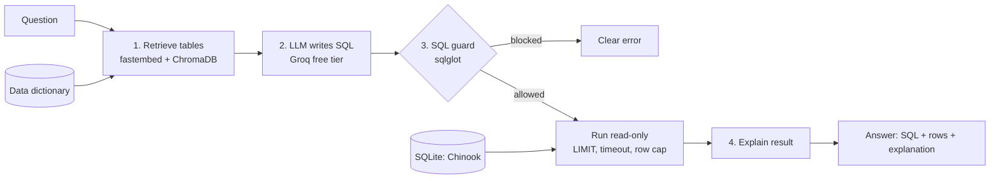

# SQL + RAG Analyst (with MCP)


Ask a plain-English question about a database. The system **retrieves the relevant tables** from a data dictionary (RAG), has an **LLM write read-only SQL**, **validates it with a parser-based guard**, runs it safely, and **explains the result**. The same pipeline is exposed as an **MCP server** (for AI agents) and a **FastAPI service**, and it is evaluated on 40 questions with verified gold SQL.

**[Recorded demo page](https://anjalikaekanayaka.github.io/sql-rag-analyst/)**: real pipeline outputs, each checked automatically against the verified answer (one failure included on purpose). There is no live backend: the project needs a Python server and a rate-limited free LLM API, and Hugging Face now requires a paid plan for Docker Spaces. Run it locally with the steps below.

## How it works



- **Retrieval:** the dictionary (11 tables, 64 columns) is split into 28 chunks, embedded with `BAAI/bge-small-en-v1.5` (ONNX, runs on a 4 GB laptop) and stored in ChromaDB. Each question retrieves the top-k tables.
- **Generation:** an LLM behind a small provider interface (Groq free tier, `openai/gpt-oss-20b` by default), with an on-disk cache and retry/backoff so the free quota is not wasted.
- **Guard:** see *Safety design* below.
- **Interfaces:** MCP server (3 tools, 1 resource) and a FastAPI service (`/health`, `/schema`, `/ask`).

## Quick start

```bash
git clone https://github.com/AnjalikaEkanayaka/sql-rag-analyst
cd sql-rag-analyst
python -m venv .venv
.venv\Scripts\activate            # Linux/macOS: source .venv/bin/activate
pip install -r requirements.txt
# create a .env file containing:  GROQ_API_KEY=your_key   (free key: console.groq.com)
python -m src.retrieval build     # downloads the embedding model (~130 MB) and builds the index
```

Run it:

```bash
python -m uvicorn src.api:app --port 8000        # API docs at http://localhost:8000/docs
python src/mcp_server.py                         # MCP server over stdio
npx @modelcontextprotocol/inspector .venv/Scripts/python.exe src/mcp_server.py   # inspect it (use forward slashes)
python -m scripts.mcp_agent --prompt "Which genre has the most tracks?"          # an LLM agent calling the MCP tools
python -m eval.run_eval --name baseline --k 4    # reproduce the evaluation (about 40 LLM calls)
python -m pytest -q --cov=src                    # tests
```

The Chinook database (`data/chinook.db`, about 1 MB) and the data dictionary are included. A `Dockerfile` is built and smoke-tested in CI.

## Safety design

The LLM's SQL is treated as **untrusted input**, so protection lives in the server and does not rely on the prompt or the client.

| Layer | Stops |
|---|---|
| sqlglot parse, exactly one statement | `SELECT 1; DROP TABLE x` |
| Root must be SELECT (or UNION etc.) | INSERT, UPDATE, DELETE, DROP, ALTER, CREATE, PRAGMA, ATTACH, VACUUM |
| Scan inside the query | a write hidden in a CTE |
| Function blocklist | `load_extension`, `readfile`, `zeroblob` and other file or memory abuse |
| Table allowlist from the dictionary | unknown tables, `sqlite_master`, schema-qualified names, table-valued functions |
| `LIMIT` enforced | oversized results |
| Read-only connection, `query_only` | writes, even if the guard had a bug (tested) |
| Timeout and row cap | runaway queries |
| Audit log | every query, allowed or blocked |
| Optional strict mode (`STRICT_TABLES=1`) | only the retrieved tables are allowed (least privilege) |

The user's question is placed inside tags and declared to the model as data, which is a first layer only: the guard is the real protection. About 30 attack cases are automated tests. The executed SQL is the one regenerated from the validated parse tree, with comments stripped.

## Evaluation

**Method.** 40 questions (15 easy, 15 medium, 10 hard) over Chinook, each with gold SQL that was **verified by running it** (and passing the guard). *Execution accuracy* means the generated query returns the same result set as the gold query (order-insensitive, numbers rounded to 2 decimals, extra or missing columns count as wrong). *Hit-all@k* is the share of questions where every needed table was retrieved; gold tables are extracted from the gold SQL automatically. One question is worth 2.5 points, so differences of one or two questions are noise. Every experiment was run separately against the baseline; all runs are in [`eval/results.md`](eval/results.md).

**Retrieval (dense search, no LLM):**

| k | 1 | 2 | 3 | **4** | 5 | 6 |
|---|---|---|---|---|---|---|
| Hit-all@k | 0.425 | 0.675 | 0.825 | **0.900** | 0.925 | 0.975 |
| Recall@k | 0.650 | 0.834 | 0.929 | **0.962** | 0.980 | 0.990 |

**End to end (execution accuracy):**

| Setting | Accuracy | Easy | Medium | Hard |
|---|---|---|---|---|
| Unrestricted tables, k=4 (baseline) | 97.5% (39/40) | 100% | 100% | 90% |
| Strict: only retrieved tables, k=4 | 90.0% (36/40) | 100% | 93.3% | 70% |
| Strict, no foreign-key hints, k=4 (**most conservative**) | 87.5% (35/40) | 100% | 86.7% | 70% |
| No schema in the prompt (control) | 55.0% (22/40) | 20% | 86.7% | 60% |
| Unrestricted, k=2 | 82.5% (33/40) | 100% | 86.7% | 50% |
| Strict, k=2 | 65.0% (26/40) | 100% | 53.3% | 30% |

**What the experiments showed**

1. **`k` is the main retrieval lever.** BM25, hybrid (reciprocal-rank fusion) and a foreign-key rerank gave no reliable gain over plain dense search; the one nominal +1 question was post-hoc and is not claimed.
2. **The 97.5% is flattered.** Four questions had a needed table missing from the prompt, yet three were still answered correctly. A control showed the model's memory of Chinook is weak (it guessed table names from other Chinook variants), and the real cause was the `REFERENCES` lines in the prompt naming neighboring tables. Removing them, or restricting the guard to retrieved tables, gives the conservative 87.5% to 90%.
3. **Accuracy is limited by retrieval, not generation.** With strict tables, accuracy equals hit-all (90.0% vs 0.900 at k=4); given complete retrieval the model was right 35 of 36 times.
4. **Prompt tweaks did not help.** Column descriptions, sample values, few-shot examples and an error-retry loop all scored 35/40 on the realistic setting while adding 41% to 64% more prompt. The retry loop turned two loud blocked queries into silent wrong answers, so it is off by default.
5. **Failure analysis.** Four of five failures are retrieval misses on tables mentioned only through a *value* ("Iron Maiden", "AC/DC", "Jazz", "Rock") or an *action* ("bought"). One is an ambiguous question (LEFT vs inner join); the gold was not edited after seeing results.

## Tests and CI

TODO-FILL tests, TODO-FILL% line coverage (`pytest-cov`). Covered: the SQL guard (attack and normal cases), the LLM layer (cache, retry, backoff, thread safety), the pipeline, retrieval (without the embedding model), the evaluation harness and the benchmark's integrity (all 40 gold queries pass the guard; example prompts never overlap the benchmark), the MCP server and the API. GitHub Actions runs the tests and builds the Docker image, then smoke-tests the container (`/health`, real `/schema` retrieval, input validation). The dense-retrieval path with the real embedding model is not exercised in CI.

## Limitations

- **Small public database.** Chinook has 11 tables. These results do not show how retrieval scales to hundreds of tables, and a private schema (cryptic names, undeclared foreign keys, business definitions) would be harder.
- **Small benchmark** (40 questions), written with an AI assistant and verified by execution; single model, single run each.
- **Retrieval misses** on tables referenced by values or actions; there is no value-aware schema linking yet.
- **Generated SQL can be silently wrong.** The API and MCP tools return the SQL and the tables used so answers can be audited.
- **Prompt injection through data:** result rows are shown to the LLM for the explanation. Impact is limited (it cannot execute anything), but it is a real surface.
- **Not hardened for public exposure:** no authentication or rate limiting; one process, requests serialized.
- **The MCP tool-description testing is qualitative** (6 prompts, one model).
- Free-tier LLM limits shaped how many experiments could be run per day.

## Future work

Value-based schema linking (index distinct values of low-cardinality columns), an explicit "cannot answer" option, authentication and rate limiting, and a test on a larger, private-style schema.

## Project layout

| Path | What |
|---|---|
| `src/retrieval.py` | chunking, embeddings, ChromaDB index, dense / BM25 / hybrid retrieval |
| `src/llm.py` | provider interface, Groq client, disk cache, retry/backoff |
| `src/sql_guard.py` | validation, read-only execution, timeout, logging |
| `src/pipeline.py` | question to SQL to result to explanation |
| `src/mcp_server.py`, `src/api.py` | MCP server and FastAPI service |
| `eval/` | evaluation harness and `results.md` |
| `data/` | Chinook database, data dictionary, 40-question benchmark |
| `scripts/` | setup helpers, MCP smoke test and agent, demo-data generator |
| `docs/` | the static demo page |
| `tests/` | the test suite |

Sample data: the Chinook database (github.com/lerocha/chinook-database). Check its license before redistributing.

## Process

Built over 12 days as a learning project, working with an AI pair-programming assistant (Claude). All numbers come from runs on my own machine, including the poor ones.